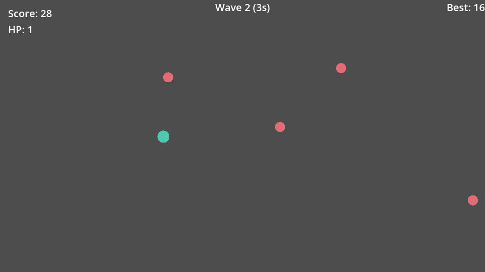

# Escape From Swarm

A small top-down arena survival game built with **Godot 4**.

You are trapped in an arena while swarms of geometric creatures close in from
every side. Your gun aims itself — all you have to do is keep moving.



## Play

| Platform | How |
|---|---|
| Windows | Download `EscapeFromSwarm-windows.zip` from [Releases](../../releases), unzip and run `EscapeFromSwarm.exe` |
| Browser | Web build coming with the first release |

## Controls

| Action | Key |
|---|---|
| Move | `W` `A` `S` `D` |
| Shoot | Automatic — fires at the nearest enemy |
| Restart after game over | `Enter` |

## Features

- Auto-aiming shooting, so movement is the whole skill
- Enemies spawn just outside the arena and chase you down
- 20-second waves with a rising difficulty curve
- HP with a short invulnerability window (and blinking feedback)
- Score plus a best score that survives restarts
- Hit flash, screen shake and procedurally synthesized sound effects
- **No external art or audio assets** — every circle is drawn in code and every
  sound is generated as raw PCM at startup

## Run from source

Requires **Godot 4.7** (standard build, not the .NET one).

```bash
git clone https://github.com/Fran02X/escape-from-swarm.git
```

Open Godot, click **Import**, select `project.godot`, then press `F5`.

The project uses the **Compatibility** renderer: it runs on older integrated
GPUs and can be exported to the web.

## Project structure

```
escape-from-swarm/
├── scenes/          # main, player, enemy and bullet scenes
├── scripts/         # gameplay scripts
├── docs/            # screenshots used by this README
└── project.godot
```

## How it works

| Script | Responsibility |
|---|---|
| `scripts/main.gd` | Waves, score, difficulty ramp, screen shake, game over |
| `scripts/player.gd` | Movement, auto-aim, shooting, health, invulnerability |
| `scripts/enemy.gd` | Chasing, damage, hit flash, death signal |
| `scripts/bullet.gd` | Travel, hit detection, lifetime |
| `scripts/sfx.gd` | Synthesizes short tones and noise bursts into `AudioStreamWAV` |
| `scripts/audio.gd` | Autoload that plays one-shot sounds |

The high score is stored with `ConfigFile` in `user://save.cfg`.

## Roadmap

- [x] **v0.1** — playable arena loop: move, shoot, survive, restart
- [ ] **v0.2** — enemy variety and weapon upgrades
- [ ] **v0.3** — upgrades between waves
- [ ] **v1.0** — balance and polish

## Contributing

Issues and pull requests are welcome. For anything larger than a small fix,
please open an issue first so we can agree on the direction.

## License

[MIT](LICENSE)
